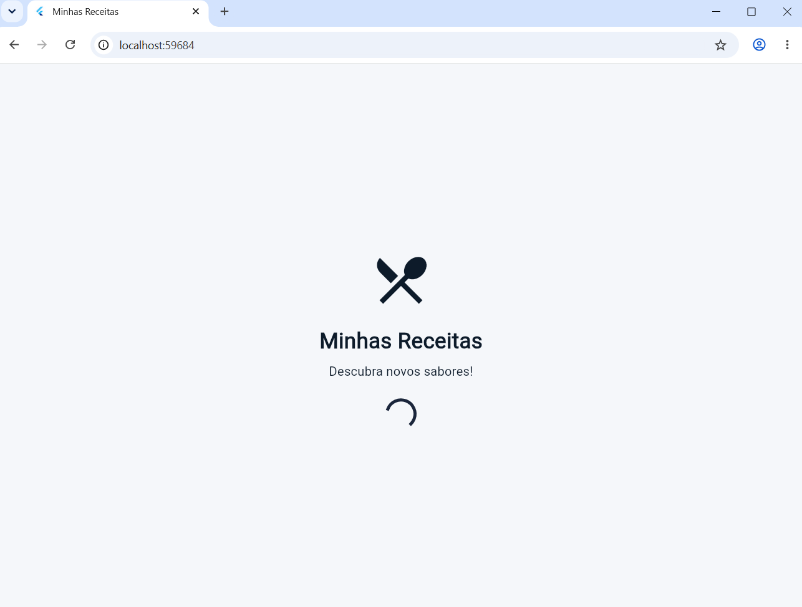
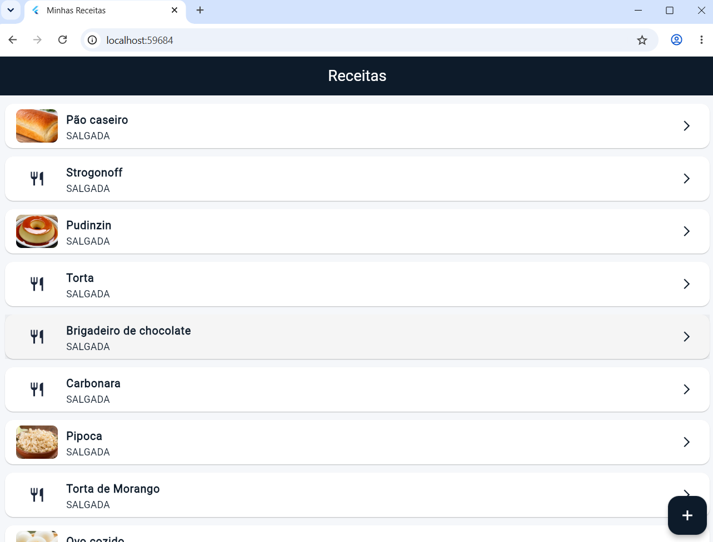
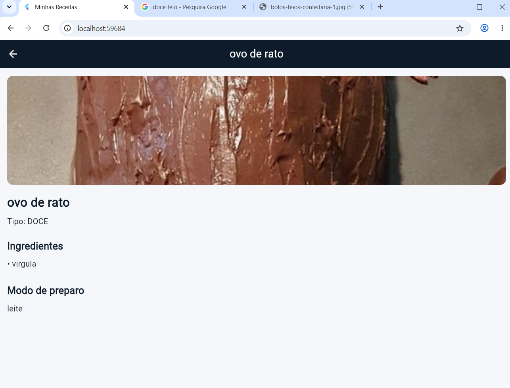

# 🍳 Flutter Recipe

Aplicativo de receitas desenvolvido com Flutter e Dart, com uma interface simples e intuitiva para visualizar receitas culinárias.

## 📱 Prints do aplicativo

  
  

  

## 🛠️ Tecnologias utilizadas

- Flutter
- Dart
- Material Design

## 👨‍💻 Desenvolvido por

**Matheus**

---

Projeto desenvolvido para praticar desenvolvimento de aplicativos mobile com Flutter e Dart.
